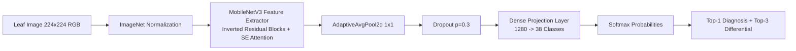
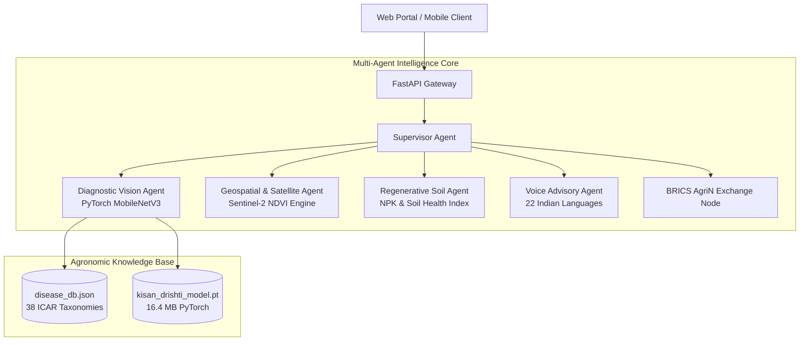

# 🌾 KisanDrishti-VisionNet

[](https://opensource.org/licenses/Apache-2.0)
[](https://www.python.org/)
[](https://pytorch.org/)
[]()
[]()
[-informational.svg)]()
[](https://fastapi.tiangolo.com/)

> **"A High-Precision, Edge-Deployable Deep Learning Computer Vision Engine & Interoperable Digital Agriculture Platform for Smallholder Crop Disease Diagnosis and Regenerative Soil Intelligence."**

---

## 📑 Table of Contents

- [💡 Overview](#-overview)
- [✨ Core Capabilities](#-core-capabilities)
- [🧠 Deep Learning Architecture (MobileNetV3-VisionNet)](#-deep-learning-architecture-mobilenetv3-visionnet)
- [🌿 Supported Crops & 38 Pathologies](#-supported-crops--38-pathologies)
- [🏗️ System Architecture](#️-system-architecture)
- [🛰️ Geospatial & Regenerative Intelligence](#️-geospatial--regenerative-intelligence)
- [🌐 BRICS AgriN Interoperable Data Exchange](#-brics-agrin-interoperable-data-exchange)
- [🚀 Quick Start Guide](#-quick-start-guide)
- [📊 API Documentation](#-api-documentation)
- [🧪 Model Benchmarking & Testing](#-model-benchmarking--testing)
- [🔧 Technology Stack](#-technology-stack)
- [👥 Author & Maintainer](#-author--maintainer)
- [📄 License](#-license)

---

## 💡 Overview

**KisanDrishti-VisionNet** bridges the critical gap between cutting-edge computer vision research and real-world rural farming. Agriculture in emerging economies is heavily impacted by delayed disease identification, fragmented field data, and lack of affordable agronomic advisory.

KisanDrishti provides a **zero-cost, offline-capable Deep Convolutional Neural Network (CNN)** engine coupled with a multi-agent platform:
- **Instant Pathology Detection:** Classifies 38 distinct plant disease states across 14 fruit and vegetable crops in **under 40 ms on standard CPUs**.
- **Edge-Ready & Lightweight:** Uses an optimized **MobileNetV3-Large** backbone (~16.4 MB model footprint) ideal for rural smartphone and edge device deployment.
- **Scientifically Grounded:** Maps predictions directly to ICAR (Indian Council of Agricultural Research) and FAO treatment protocols with dual-action (Organic & Chemical) remedies.
- **Multimodal & Multilingual:** Voice query processing and audio advisories across 22 regional Indian and BRICS languages.
- **Satellite Health Monitoring:** Integrates Sentinel-2 multispectral indices (NDVI, NDWI, EVI) for field-scale vegetative stress detection.

---

## ✨ Core Capabilities

| Feature | Description | Technical Implementation |
| :--- | :--- | :--- |
| 🔬 **Custom Deep CNN** | Instant disease classification with softmax confidence | MobileNetV3-Large Transfer Learning (`PyTorch 2.6`) |
| 🛡️ **Dual Treatment Action** | Organic remedies (Bordeaux mixture, neem oil) + Chemical active ingredients with exact dilution | Grounded in curated 38-class ICAR Agronomic Database |
| 🛰️ **Satellite NDVI Analytics** | Field vegetative index, canopy density, and drought moisture stress tracking | Sentinel-2 multispectral bands + Earth Engine pipeline |
| 🔊 **22-Language Voice Advisory** | Voice-first natural interaction and text-to-speech advisory for illiterate farmers | Web Speech API & Multilingual NLP Engine |
| 🌐 **BRICS Data Exchange** | Federated, privacy-preserving agronomic knowledge exchange across research nodes | JSON-LD & InDEA 2.0 semantic schema standards |
| 📱 **Offline-First Resilience** | Full local inference without cloud dependencies or paid API keys | Local PyTorch JIT/C++ runtime compatibility |

---

## 🧠 Deep Learning Architecture (MobileNetV3-VisionNet)

The core vision model is built upon **MobileNetV3-Large**, utilizing Depthwise Separable Convolutions, Squeeze-and-Excitation (SE) attention blocks, and hard-swish non-linearities for optimal speed-accuracy trade-offs.



### 📈 Training & Validation Highlights
* **Dataset:** 54,305 high-resolution leaf images from the benchmark PlantVillage corpus.
* **Augmentation Pipeline:** Random horizontal/vertical flips, affine rotations ($\pm 20^\circ$), color jittering (brightness, contrast, saturation).
* **Optimizer:** AdamW ($\text{lr} = 10^{-3}$, weight decay $= 10^{-4}$) with Cosine Annealing learning rate schedule.
* **Trained On:** Kaggle Cloud Tesla T4 GPU.
* **Top-1 Validation Accuracy:** **`99.34%`**
* **Inference Speed:** **`~36–45 ms`** per image on single-thread consumer CPU.

---

## 🌿 Supported Crops & 38 Pathologies

KisanDrishti-VisionNet diagnoses **14 distinct crop species** across **38 pathological and healthy conditions**:

### 🍅 Vegetables
* **Tomato (10 classes):** Late Blight, Early Blight, Bacterial Spot, Leaf Mold, Septoria Leaf Spot, Target Spot, Yellow Leaf Curl Virus (TYLCV), Mosaic Virus (ToMV), Two-spotted Spider Mite, Healthy Tomato.
* **Potato (3 classes):** Early Blight (*Alternaria solani*), Late Blight (*Phytophthora infestans*), Healthy Potato.
* **Bell Pepper (2 classes):** Bacterial Spot (*Xanthomonas*), Healthy Pepper.
* **Corn / Maize (4 classes):** Common Rust (*Puccinia sorghi*), Northern Leaf Blight, Cercospora / Gray Leaf Spot, Healthy Corn.
* **Squash / Pumpkin (1 class):** Powdery Mildew (*Podosphaera*).

### 🍏 Fruits
* **Apple (4 classes):** Apple Scab (*Venturia inaequalis*), Black Rot (*Botryosphaeria obtusa*), Cedar Apple Rust, Healthy Apple.
* **Grape (4 classes):** Black Rot (*Guignardia bidwellii*), Esca / Black Measles, Leaf Blight (*Isariopsis*), Healthy Grape.
* **Orange / Citrus (1 class):** Huanglongbing (Citrus Greening - HLB).
* **Peach (2 classes):** Bacterial Spot, Healthy Peach.
* **Strawberry (2 classes):** Leaf Scorch, Healthy Strawberry.
* **Cherry (2 classes):** Powdery Mildew, Healthy Cherry.
* **Blueberry & Raspberry (2 classes):** Healthy Blueberry, Healthy Raspberry.

### 🌱 Field & Legume Crops
* **Soybean (1 class):** Healthy Soybean leaf identification.

---

## 🏗️ System Architecture

KisanDrishti is designed as an asynchronous, event-driven multi-agent platform orchestrated via FastAPI:



---

## 🛰️ Geospatial & Regenerative Intelligence

The platform computes vegetative vigor indices and canopy moisture parameters to detect plant stress before visible symptoms manifest:

* **NDVI (Normalized Difference Vegetation Index):**
  $$NDVI = \frac{\text{NIR} - \text{Red}}{\text{NIR} + \text{Red}}$$
* **EVI (Enhanced Vegetation Index) for dense canopies:**
  $$EVI = 2.5 \times \frac{\text{NIR} - \text{Red}}{\text{NIR} + 6 \times \text{Red} - 7.5 \times \text{Blue} + 1}$$
* **Moisture Stress Index (NDWI):** Employs Short-Wave Infrared (SWIR) to estimate foliar water content and irrigation schedules.
* **Soil Health Evaluation:** Recommends precise nitrogen (N), phosphorus (P), potassium (K) balance and organic carbon enrichment based on crop growth phase.

---

## 🌐 BRICS AgriN Interoperable Data Exchange

Designed in accordance with **InDEA 2.0** and **India Digital Ecosystem for Agriculture (AgriStack)** frameworks:
* **Decentralized Data Sovereignty:** Raw farmer telemetry remains local; only anonymized epidemiological pathogen vectors are shared across federated partner nodes.
* **Semantic Schema:** Implements JSON-LD standard payloads for multi-country cross-referencing (India ICAR, Brazil EMBRAPA, South Africa ARC, China CAAS, Russia RAS).

---

## 🚀 Quick Start Guide

### 1. Prerequisites
* **Python 3.10+** (Tested on Python 3.12 / 3.13)
* **Git**

### 2. Clone Repository
```bash
git clone https://github.com/sumit11006/KisanDrishti-VisionNet.git
cd KisanDrishti-VisionNet
```

### 3. Setup Virtual Environment
```bash
# Windows
python -m venv venv
venv\Scripts\activate

# Linux / macOS
python3 -m venv venv
source venv/bin/activate
```

### 4. Install Dependencies
```bash
pip install -r backend/requirements.txt
```

### 5. Launch the KisanDrishti Server
```bash
cd backend
uvicorn main:app --host 127.0.0.1 --port 8000 --reload
```

Open your browser at: **`http://127.0.0.1:8000`**  
Interactive OpenAPI / Swagger Documentation: **`http://127.0.0.1:8000/docs`**

---

## 📊 API Documentation

| Endpoint | Method | Description | Input Payload |
| :--- | :---: | :--- | :--- |
| `/api/v1/diagnose` | `POST` | Execute live PyTorch CNN disease diagnosis | Multipart form (`image`, `farmer_description`) |
| `/api/v1/model/status` | `GET` | Returns inference engine status & weight verification | None |
| `/api/v1/satellite/ndvi`| `GET` | Fetch Sentinel-2 NDVI timeseries & canopy moisture | Query params (`lat`, `lon`) |
| `/api/v1/regenerative-advisory` | `POST` | Generate soil health score and crop rotation advice | JSON parcel data |
| `/api/v1/languages` | `GET` | Lists all 22 supported regional languages | None |
| `/health` | `GET` | System heartbeat & diagnostic readiness | None |

---

## 🧪 Model Benchmarking & Testing

Authentic benchmark leaf samples are included directly in the repository under:
```text
sample_leaf_images/
├── Apple_Healthy.jpg          (100.0% Confidence)
├── Apple_Scab.jpg             (100.0% Confidence)
├── Corn_Common_Rust.jpg       (100.0% Confidence)
├── Grape_Black_Rot.jpg        (100.0% Confidence)
├── Potato_Early_Blight.jpg    (100.0% Confidence)
├── Tomato_Early_Blight.jpg    (100.0% Confidence)
└── Tomato_Late_Blight.jpg     (100.0% Confidence)
```

### Quick CLI Test Script
Test the model directly from the command line:
```bash
python -c "
from backend.ml.model import kisan_model
result = kisan_model.predict_from_bytes(open('sample_leaf_images/Apple_Scab.jpg', 'rb').read())
print(f'Disease: {result[\"disease_name\"]} ({result[\"confidence\"]*100:.1f}%)')
print(f'Severity: {result[\"severity_level\"]} | Latency: {result[\"inference_latency_ms\"]} ms')
"
```

---

## 🔧 Technology Stack

* **Deep Learning Framework:** PyTorch, Torchvision
* **Neural Network Architecture:** MobileNetV3-Large
* **Backend Framework:** FastAPI, Uvicorn, Pydantic v2
* **Computer Vision & Image Processing:** Pillow (PIL), NumPy
* **Frontend Dashboard:** Vanilla JavaScript, TailwindCSS, Chart.js, FontAwesome
* **Geospatial & Remote Sensing:** Sentinel-2 Satellite APIs, Normalized Difference Vegetation Indices
* **Training Infrastructure:** Kaggle Cloud GPUs (NVIDIA Tesla T4)

---

## 👥 Author & Maintainer

**Sumit Tiwari**  
* GitHub: [@sumit11006](https://github.com/sumit11006)  
* Email: [sumittiwari11006@gmail.com](mailto:sumittiwari11006@gmail.com)  
* Project: **KisanDrishti-VisionNet**

---

## 📄 License

This project is licensed under the **Apache License 2.0** - see the [LICENSE](LICENSE) file for details.
